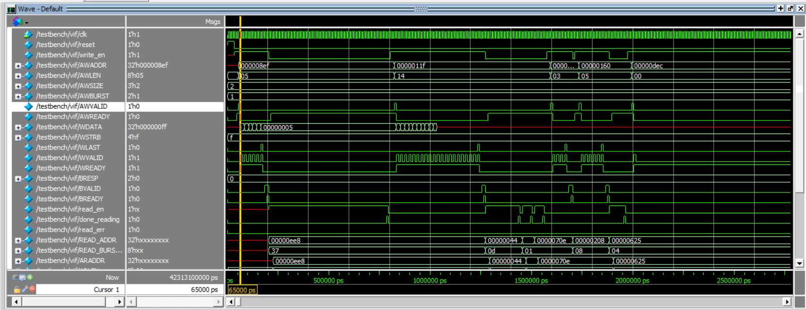
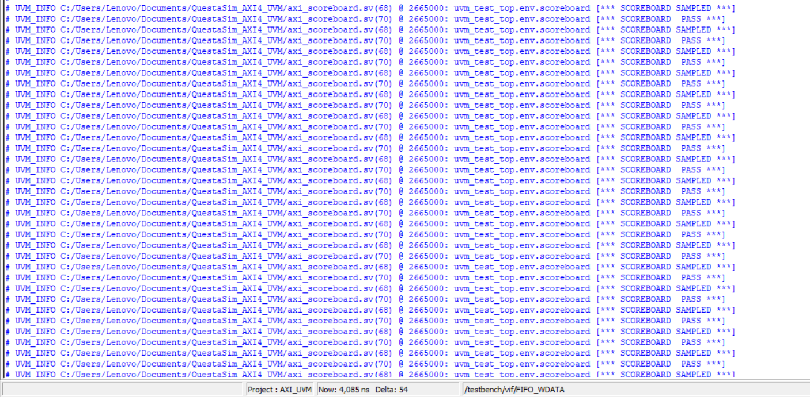
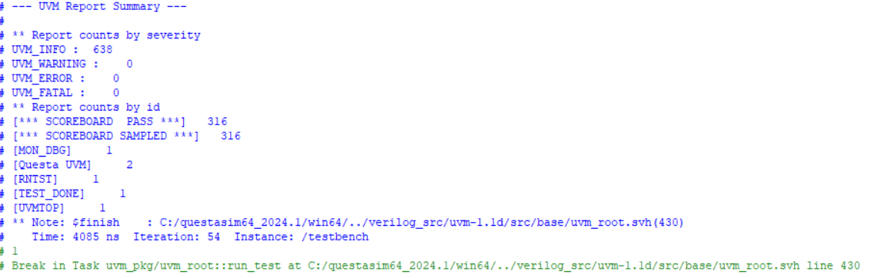
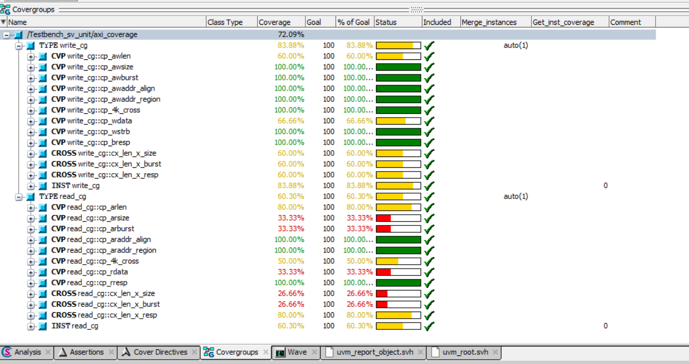

# AXI4 Protocol Verification Using UVM

A SystemVerilog-based verification project focused on verifying the **AMBA AXI4 protocol** using the **Universal Verification Methodology (UVM)**.

## Overview

The Advanced eXtensible Interface 4 (AXI4) is part of the AMBA protocol family developed by Arm. It is widely used in System-on-Chip (SoC) architectures to enable high-performance communication between different hardware components.

This project focuses on developing a structured UVM-based verification environment to simulate and analyze AXI4 protocol behavior.

The main objective is to explore the principles of functional verification, understand UVM testbench architecture, and evaluate protocol behavior through simulation, waveform analysis, and coverage reporting.

## Project Objectives

- Understand the AMBA AXI4 protocol and its communication mechanisms.
- Develop a structured verification environment using SystemVerilog and UVM.
- Organize RTL, testbench, UVM components, and simulation files.
- Execute simulations and analyze signal-level behavior.
- Generate and inspect verification and coverage reports.
- Gain practical experience with hardware verification methodologies.

## Repository Structure

```text
AXI4-Protocol-Verification-Using-UVM/
│
├── rtl/                  # RTL design files
│
├── tb/                   # Testbench files and interfaces
│
├── uvm/                  # UVM verification components
│
├── sim/                  # Simulation-related files and scripts
│
├── coverage_report.png   # Coverage report screenshot
├── test_waveform.png     # Simulation waveform screenshot
├── uvm_output.png        # UVM simulation output
├── uvm_report.png        # UVM report screenshot
│
└── README.md
```

## Technologies and Tools

| Technology | Purpose |
|---|---|
| SystemVerilog | Hardware description and verification |
| UVM | Structured, reusable verification environment |
| AXI4 | Communication protocol under verification |
| QuestaSim | HDL simulation and debugging |
| Functional Coverage | Verification progress analysis |
| Waveform Analysis | Signal-level simulation inspection |

## UVM Verification Architecture

The project is organized around the UVM methodology, which provides a reusable and modular approach to hardware verification.

The main concepts involved include:

- **Sequence Items:** Represent transactions exchanged through the verification environment.
- **Sequences:** Generate verification stimulus.
- **Sequencer:** Controls the flow of transactions.
- **Driver:** Converts transactions into interface-level signal activity.
- **Monitor:** Observes interface activity and collects transaction information.
- **Agent:** Groups the components responsible for interacting with an interface.
- **Environment:** Organizes and connects verification components.
- **Scoreboard:** Supports checking and comparing expected and observed behavior.
- **Tests:** Configure and execute verification scenarios.

## AXI4 Protocol

AXI4 uses five independent communication channels:

| Channel | Description |
|---|---|
| AW | Write Address |
| W | Write Data |
| B | Write Response |
| AR | Read Address |
| R | Read Data |

Communication relies on the VALID/READY handshake mechanism, allowing the communicating components to control when information is transferred.

Understanding these channels and their interactions is essential when developing an AXI4 verification environment.

## Simulation and Results

The repository includes simulation-related files and screenshots documenting the verification process.

### Simulation Waveform



### UVM Simulation Output



### UVM Report



### Coverage Report



These results provide visual evidence of simulation activity and the generated verification reports.

## Getting Started

### Prerequisites

To explore and run this project, you need:

- QuestaSim or another simulator supporting SystemVerilog and UVM.
- SystemVerilog language support.
- An available UVM library compatible with your simulator.

### Clone the Repository

```bash
git clone https://github.com/Youssef-Fd/AXI4-Protocol-Verification-Using-UVM.git
```

```bash
cd AXI4-Protocol-Verification-Using-UVM
```

### Run the Simulation

1. Open QuestaSim.
2. Navigate to the project directory.
3. Inspect the files inside the `sim/` directory.
4. Use the provided simulation script or file list to compile the RTL and verification environment.
5. Run the simulation.
6. Inspect the waveforms and generated reports.

*Note: The exact compilation and execution commands depend on the simulation scripts and file lists included in the project.*

## Learning Outcomes

Through this project, the following concepts are explored:

- AXI4 protocol fundamentals.
- SystemVerilog-based verification.
- UVM testbench architecture.
- Transaction-based verification.
- Modular and reusable verification components.
- Simulation debugging and waveform analysis.
- Functional coverage and verification reporting.

